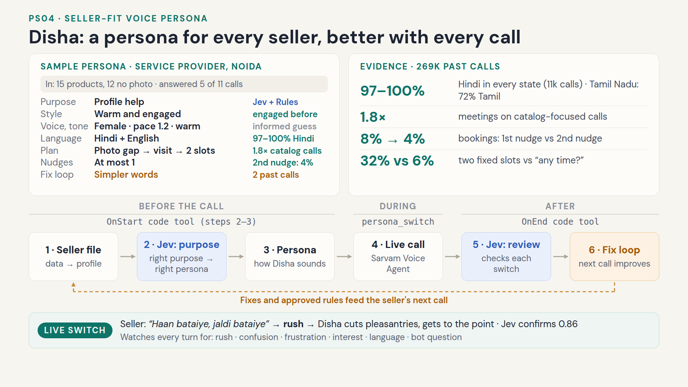

# Disha: an adaptive voice agent for IndiaMART seller calls

Disha is one Samvaad (Sarvam) voice agent whose persona is rebuilt for every seller before she speaks, adapts live
during the call, and learns from each call for the next one. Built for PS04 (seller-fit adaptive voice persona) on the
PS07 data pack.

- **Agent:** `Disha---Ind-85eb0f30-d809` on Samvaad. v1 is committed ("Version1 before Fix loop"); the current work
  is on draft **v2**, which the console uses (`DISHA_APP_VERSION=2`).
- **Decision model:** Jev (TypeSafe, `api.typesafe.ai/v1/systemone`) picks the call purpose before the call and
  reviews the call after it.
- **Conversation:** Sarvam on Samvaad: speech recognition, the conversation LLM and the voice.
- **Persona:** evidence-based rules (`generator/generate.py`), so every choice can be traced to past calls.



One-slide summary: [`Disha_One_Slide.pdf`](Disha_One_Slide.pdf) · [`Disha_One_Slide.png`](Disha_One_Slide.png)

## Start here

| I want to… | Open |
|---|---|
| See a persona for a real seller, with the reason for every choice | [`samples/personas/PERSONA_SPECS.md`](samples/personas/PERSONA_SPECS.md) |
| See live switch logs from real calls | [`samples/switch_logs/SWITCH_LOGS.md`](samples/switch_logs/SWITCH_LOGS.md) |
| See the evidence behind the choices | [`docs/evidence_report.md`](docs/evidence_report.md) |
| Read the generator | [`generator/generate.py`](generator/generate.py) |
| Understand where and why Jev is used | [Jev: where it is used and why](#jev-where-it-is-used-and-why) |
| Read what runs on Samvaad | [`samvaad/code_tool/disha_tools_src.py`](samvaad/code_tool/disha_tools_src.py), [`samvaad/disha_prompt.md`](samvaad/disha_prompt.md) |

## Submission deliverables

| Deliverable | Where |
|---|---|
| Persona generator running on sample seller files | `generator/generate.py` (also bundled into the Samvaad code tool and run before every call) |
| Persona spec per sample seller, with the reason for each choice | [`samples/personas/`](samples/personas/) (anonymised; the real specs are generated locally to `outputs/`) |
| Live demo on Sarvam, contrasting sellers, mid-call switch | `Disha Final Demo.mp4` (explainer + Demo 1 + Demo 2) |
| Switch log: signal, change, reason for every switch | [`samples/switch_logs/`](samples/switch_logs/); written on every call as `switch_log_json` and shown on the console's switch timeline |
| One-slide presentation | [`Disha_One_Slide.pdf`](Disha_One_Slide.pdf) / [`Disha_One_Slide.png`](Disha_One_Slide.png) (shown at the top of this README) |

## How a call works

1. **Sort the sellers** (offline, `outputs/segmentation/scripts/`, see [`docs/segmentation_and_call_plans.md`](docs/segmentation_and_call_plans.md)): a contact gate (SUPPRESS: do not call;
   ROUTE_TO_HUMAN: executive only; COOL_OFF: one soft ask; OK_TO_CALL), then a rules-based call purpose.
2. **Prepare the seller file**: one compact `seller_profile` JSON per seller (about 3 KB), the only per-call input.
3. **Start the call** from the Disha Console (browser or phone) or the Samvaad dashboard.
4. **OnStart code tool** (on Samvaad, before the first word): contact rule, call purpose via Jev, persona generator,
   purpose adjustments, nudge budget, call plan, seller brief, learned fixes, opening line.
5. **The conversation**: live persona switches on six signals, each logged through the `persona_switch` tool.
6. **OnEnd code tool**: one Jev request verifies each switch and reviews the call (`call_review`).
7. **Fix loop**: safe fixes go into the seller's next call; patterns across 2+ sellers become rules you approve in
   the console's Insights panel.

## How the persona is generated

### 1. Evidence from past calls (offline, once)

269,455 answered VANI calls (April to September 2026), their evaluator outputs and 139k transcript turns were analysed
into **60 evidence items** (`outputs/evidence.json`, readable in [`docs/evidence_report.md`](docs/evidence_report.md)), each with a sample size,
a baseline and a strength (strong, moderate, weak). All findings are correlational. Examples:

- Sellers who hung up within 10 s before hang up early again 50% of the time vs 25% → short, fast opening.
- Larger businesses (turnover ≥ 1.5 Cr) book fewer meetings → formal, business-value framing.
- Sellers spoke Hindi in 97–100% of transcribed calls in every state with enough calls; Tamil Nadu is the exception
  (72% Tamil) → start language by state.

Per-purpose evidence and call plans: [`docs/segmentation_and_call_plans.md`](docs/segmentation_and_call_plans.md) and [`docs/conversation_evidence.md`](docs/conversation_evidence.md).

### 2. The generator (`generator/generate.py`, no LLM)

The first matching rule picks one headline persona:

| If the seller… | Persona |
|---|---|
| refused before, was frustrated, or asked not to be called | **Calm repair**: empathy first, one soft ask |
| is a mid or large business, or a Limited Company | **Consultative**: formal, business-value framing |
| hangs up fast, or has been called many times | **Brisk**: point in the first sentence, short turns |
| engaged before (picks up, replies to enquiries) or asked for a callback | **Warm & engaged**: upbeat, moves to scheduling |
| none of the above | **Friendly default** |

Then each part is chosen with a reason, a confidence and evidence ids: voice and pace, language (start language,
English-word mix, formality, which languages to switch to), tone (warmth, empathy, energy), opening approach,
personalisation hooks, objection playbook (with the past success rate of each answer) and escalation rules.

**Not evidenced by the data:** voice gender, pitch, pace and tone levels (no past call varied them). These are informed
guesses, marked low confidence, and live switching corrects them. Disha's voice is fixed on the platform; only pace
changes per seller.

### 3. What OnStart adds on Samvaad (`samvaad/code_tool/disha_tools_src.py`)

- **Call purpose from Jev:** one request with four yes/no signals (pending commitment, ignoring leads, upgrade intent,
  inactive business) and a catalog-need score (0 to 3) → one of six purposes: `warm_followup`, `lead_engagement`,
  `free_to_paid`, `reactivation`, `profile_onboarding`, `discovery`. Cross-checked with the rules: if Jev is borderline,
  the rules decide; if Jev is slow (over 1.5 s) or fails, the rules decide. If the fallback would be `discovery` and
  the product data shows clear catalog gaps, the call becomes `profile_onboarding`.
- **Purpose adjustments:** pace and style per purpose (e.g. reactivation slower and softer, free to paid a little faster).
- **Nudge budget:** nudges allowed after a refusal, fixed per purpose from 12,354 past calls
  (`outputs/segmentation/N01_nudges.csv`): warm follow-up and free to paid 2; profile and discovery 1; lead engagement
  and reactivation 0. Lowered by the contact policy, history and the fix loop; never above 2.
- **Call plan per purpose:** the steps Disha follows, the seller replies to expect with example lines, and the
  success outcome (`CALL_PLANS`).
- **Seller brief:** what the seller sells, catalog counts, enquiries and the last two call summaries, with rules on how
  to use them naturally (never read out, never "our records show").
- **Product data** (`product data.csv`, about 1,000 sellers): products, products without a photo, without a price.
  Used in the profile-help purpose line, e.g. "Jaisa ki main dekh pa rahi hoon, aapke catalogue mein 15 products hain,
  jinmein se 12 mein photo nahi hai…". Only the counts are known, never which products.
- **Opening line:** "Hello sir, main Disha baat kar rahi hoon IndiaMART se. {company} se baat ho rahi hai?" (Hindi;
  English, Tamil and 8 more languages have their own).
- **Fixes from the fix loop:** start language, pace, simpler words, fewer nudges, notes. The contact policy is never
  overridden.

### 4. Generate a persona: what to pass

`generate_persona(row)` in `generator/generate.py` takes **one flat seller row** (a JSON object / Python dict) and
returns the persona spec. There are three ways to call it:

| You have | Run |
|---|---|
| A **GLID** (seller id) and the PS07 data locally | `.venv/bin/python -m generator.generate --seller-id <GLID>` (builds the row from the data with `seller_row()`) |
| A **seller-row JSON file** (no data needed) | `.venv/bin/python -m generator.generate --row generator/example_seller_row.json` |
| Python code | `from generator.generate import generate_persona; spec = generate_persona(row_dict)` |

The spec is printed and written to `outputs/personas/<fk_glusr_usr_id>.json` (`--out <dir>` to change).

**Row format:** [`generator/seller_row.schema.json`](generator/seller_row.schema.json) (JSON Schema) and a complete
synthetic example, [`generator/example_seller_row.json`](generator/example_seller_row.json):

```json
{
  "fk_glusr_usr_id": 1000001,
  "company": "Example LED Traders",
  "seller_state": "Rajasthan", "seller_city": "Jaipur", "seller_locality": "Malviya Nagar",
  "annual_turnover": "0 - 40 L",
  "business_type": "Proprietorship",
  "nature_of_business": "Trader - Wholesaler/Distributor",
  "top_category_1": "LED Module", "top_category_2": "Round LED Light", "top_category_3": "LED COB Light",
  "top_category_group": "Lights, Lighting Fixtures and Components",
  "gst_registration_year": 2019,
  "eng_pickup_ratio_1yr": 40, "eng_enq_received_90d": 6, "eng_enq_replies_90d": 1,
  "eng_cqs": 12, "eng_product_count": 18,
  "bot_answered": 7, "bot_attempts": 12, "avg_answered_call_sec": 21.5,
  "calls_meeting_fixed": 0, "calls_not_interested": 0, "calls_call_later": 0,
  "ctx_early_calls": 4, "ctx_last_bucket": "PIM",
  "past_dispositions_detailed": "call_dropped (2); general (3)",
  "past_objections": null,
  "past_questions_asked": "Clarification (1)",
  "asked_if_talking_to_bot": 0, "showed_frustration": 0,
  "already_in_touch_with_executive": 0, "do_not_call_requested": 0
}
```

This example comes out as the **brisk** persona (4 of 7 answered calls ended within 10 s), Hindi with English
business words, pace 1.35.

| Field(s) | Type and values | Used for |
|---|---|---|
| `fk_glusr_usr_id` | integer (GLID) | the spec's `seller_id` |
| `company` | string | confirming the business by name |
| `seller_state`, `seller_city`, `seller_locality` | strings, e.g. `"Uttar Pradesh"` | region and start language |
| `annual_turnover` | `"0 - 40 L"`, `"40 L - 1.5 Cr"`, `"1.5 - 5 Cr"`, `"5 - 25 Cr"`, `"25 - 100 Cr"`, `"100 - 500 Cr"`, `"> 500 Cr"` | 1.5 Cr and above → consultative |
| `business_type` | `"Proprietorship"`, `"Partnership"`, `"Limited Company"`, `"Others"` | Limited Company → consultative |
| `nature_of_business` | e.g. `"Manufacturer"`, `"Trader - Retailer"`, `"Trader - Wholesaler/Distributor"`, `"Service Provider and Others"` | business kind, formality |
| `top_category_1..3`, `top_category_group` | strings | what they sell, personalisation |
| `gst_registration_year` | integer | how new the business is |
| `eng_pickup_ratio_1yr` | 0–100 (percent) | over 50 → engaged |
| `eng_enq_received_90d`, `eng_enq_replies_90d` | counts | 3+ replies → engaged; enquiry hooks |
| `eng_cqs`, `eng_product_count` | catalog score 0–100, product count | catalog hooks |
| `bot_answered`, `bot_attempts` | counts of past VANI bot calls | history, repeat attempts → brisk |
| `avg_answered_call_sec` | seconds | under 12 → fast hang-up → brisk |
| `calls_meeting_fixed`, `calls_not_interested`, `calls_call_later` | counts | refusals → calm repair; callbacks → warm |
| `ctx_early_calls` | count of past calls under 10 s | fast hang-up → brisk |
| `ctx_last_bucket` | trigger code of the last call, e.g. `"PIM"`, `"PAM"`, `"OLP"`, `"NUR"`, `"SCHD"` | why IndiaMART called; warm & engaged for PAM, NUR, SCHD |
| `past_dispositions_detailed`, `past_objections`, `past_questions_asked` | `"label (count); label (count)"` | objection playbook and opening |
| `asked_if_talking_to_bot`, `showed_frustration`, `already_in_touch_with_executive`, `do_not_call_requested` | 0 or 1 | frustration or do-not-call → calm repair |

Every field is optional and may be `null`: missing values fall back to defaults and the affected choices are marked low
confidence (`{}` gives the friendly default persona). Extra fields are ignored.

**Output:** a JSON spec with `seller_id`, `seller_snapshot`, `delivery_profile`, `voice`, `language`, `tone`, `plan`
(`opening`, `personalisation`, `objection_playbook`, `escalation_rules`, `target_call_sec`), `guardrails`, `facts`
and `evidence_refs`. Every choice has a `reason` and a `confidence`. See [`samples/personas/`](samples/personas/).

**On Samvaad** the same generator runs inside Disha's OnStart. There, the one per-call variable `seller_profile` wraps
this row: `{"v": 1, "seller_id": …, "gen": <seller row>, "jev": <state Jev scores>, "rules": {"use_case",
"contact_policy", "gate_reason"}}`, built by `tools/export_profiles.py`. OnStart then adds the call purpose, call plan,
nudge budget, seller brief and opening line.

**Full specs for sample sellers** (generator + OnStart, with live Jev; needs the console running):

```bash
.venv/bin/python -I tools/export_specs.py [GLID ...]   # or DISHA_SPEC_SELLERS in .env
```

It writes the real specs to `outputs/personas/` and `outputs/PERSONA_SPECS.md` (local only) and an anonymised copy to
`samples/personas/`.

## Jev: where it is used and why

Jev (TypeSafe's System One model, `api.typesafe.ai/v1/systemone`) turns a seller's state into typed judgements with
probabilities: yes/no questions ("Nouls"), scores and choices, each with a probability instead of free text. Disha
uses it twice per call, always from the code tool, never from the conversation LLM.

| Where | When | What Jev gets | What it returns | What Disha does with it |
|---|---|---|---|---|
| **Call purpose** (`OnStart`, `jev_call`) | before the first word | the seller's state: profile, catalog, buyer demand, call history with the last call summaries, objections and questions (`seller_profile.jev`), plus typical-seller reference values | 4 yes/no signals with probabilities (pending commitment, ignores leads, upgrade intent, inactive business) and a catalog-need score from 0 to 3 | picks one of six purposes; when a signal is within the margin of its cut-off, Jev is borderline and the rules decide; confidence is high only when Jev and the rules agree; over 1.5 s or an error → the rules decide |
| **Switch check and call review** (`OnEnd`, `review_call`) | after hang-up, one request (with fewer than 3 seller turns, only the switch check) | the transcript, the switch log and what OnStart chose | per switch: how strongly the transcript supports the signal (`verified_signal`) and whether the change was applied; for the call: the purpose in hindsight, the seller's language, wanted faster / slower / simpler, irritation from pushing, goal met | writes `switch_log_json` and `call_review`; the review becomes the fix loop's fixes for the seller's next call and, across 2+ sellers, suggested rules |

**Why Jev and not only rules**

- **It reads text the rules cannot.** Call summaries, objections and questions are free text ("seller said call
  after Diwali", "already met an executive"). Rules only see counts and flags.
- **Probabilities, not just labels.** Each signal comes with a probability, so Disha knows when the purpose is a
  close call (borderline → the rules decide, confidence medium) instead of acting on a coin flip.
- **The same model checks the call afterwards.** Verifying a switch ("does the transcript show the seller was in a
  rush?") and judging the call in hindsight needs reading a transcript; one Jev request does both.
- **Fast and cheap enough to run before every call:** median 0.33 s, about 1.6k input and 170 output tokens per
  seller, 2,100 sellers in 90 s with 0 errors on the validation run.
- **Easy to change:** the questions are plain-language strings in the code tool (`NOULS`, `CATALOG_LEVELS`), so a
  purpose can be refined without retraining anything.

**How well it works** ([`docs/jev_validation.md`](docs/jev_validation.md), 2,100 sellers held out, scored against their
September outcomes): Jev's signals separate outcomes as well as the rules, with a slight lean to Jev (Cramér's V 0.093
vs 0.089; the difference is not significant). It agrees with the rules for 70% of sellers (κ 0.64), and where they
disagree, Jev's labels separate outcomes a little better (0.113 vs 0.101, directional). Its groups are sharper: Jev's
profile-help sellers book 20.2% vs 16.0% for the rules'. That is why the two are combined (Jev first, rules as the
cross-check and fallback) rather than one replacing the other.

The secret `TYPESAFE_API_KEY` lives in the Samvaad workspace (code tools read it with `context.get_secret`); the
console's preview records every Jev request and answer so you can see exactly what was asked.

## During the call

- **Live switches:** every seller turn is checked for rush, confusion, frustration, interest, a language change, or a
  bot question. Disha calls `persona_switch` first (signal, the seller's words, the change, the reason; for language,
  the new language), then replies in the new style. The switch is logged with its time.
- **Language:** she replies in the language of the seller's latest turn and switches back if they do.
- **Rules that always hold:** no price is ever quoted; visits Monday to Saturday, 11 am to 5 pm; a limit is explained
  once, and if the seller keeps pressing, the request is taken forward ("main apne manager se confirm karke batati
  hoon…") instead of refused again; no fillers such as "Arre"; one closing thank-you in the call's language ("Thank
  you sir!" in Hindi and English); dates only from the call calendar, never a Sunday visit.
- **Not the right person:** a polite check for an employee first; an employee is asked for the owner; an ex-employee
  is asked once for the owner's current number (`alternate_contact`, outcome `contact_referred`); otherwise a short
  apology and close.

## After the call

- **Switch log** (`switch_log_json`): every switch with time, signal, seller words, change, reason, language before
  and after, and Jev's verification score.
- **Call review** (`call_review`, same Jev request): was the purpose right in hindsight, the seller's language, signs
  of wanting faster or simpler, irritation from pushing, nudges used, and the fixes for the next call.
- **Outcome variables:** `disposition` (meeting_scheduled, rescheduled, callback_requested, declined, business_closed,
  voicemail_left, no_answer, contact_referred, wrong_number), `meeting_date`, `meeting_time`, `call_summary`,
  `seller_notes` (with "Pending confirmation:" for requests taken forward), `alternate_contact`.
- **Fix loop** (`ui/learning.py`): fixes per seller go into the next call's `seller_profile`; patterns from 2+ sellers
  become suggested rules, applied only after approval in Insights.

## Samvaad setup

- Upload `samvaad/code_tool/disha_tools.py` to the Disha draft (Tools → Upload Python file) after every rebuild.
  The workspace secret `TYPESAFE_API_KEY` must exist.
- The prompt source is `samvaad/disha_prompt.md` (deployed to the draft with `configure_agent`). `{{persona_notes}}`
  appears exactly once in it; every other reference says "the persona notes" (the notes are about 7 KB and are
  inserted at every mention).
- **Dashboard defaults:** the draft is prefilled with one demo seller (free to paid, brisk, Hindi), so
  anyone can place a test call or chat without entering anything. Console phone calls borrow the same
  `seller_profile` default and put the demo seller back afterwards (`DISHA_DEFAULT_SELLER` in `.env`).

## Disha Console (`ui/`)

`http://localhost:7862`: seller list (demo, custom, product-data sellers, any seller id), local OnStart preview with
the recorded Jev request and answers, browser call (live transcript and switches) and phone call to the verified test
number (`DISHA_TEST_PHONE`; Samvaad gives phone calls no live feed, so the transcript and switch timeline appear after
hang-up), call output and review, the fix loop per seller, Insights (rule approval) and an animated Flow page.

## Explainer video

`outputs/video/`: `voiceover_script_en.json` (2:00, one line per scene), `make_voiceover.py` (ElevenLabs Sarah with an
Indian English accent, or Sarvam Bulbul v3 voices with `--lang en-IN`), `mix_final.py` (film music ducked under the
voice). Final cut: the explainer with the ElevenLabs voice, a 1.8 s "Demo 1" card with "Let's see the demo", Video 1, a
1 s "Demo 2" card, Video 2 (HDR converted to SDR, portrait video on a blurred background, audio levelled to −14 LUFS).

## Layout

```
README.md
Disha_One_Slide.pdf / .png   the one-slide summary
samples/              persona specs and switch logs for sample sellers (anonymised)  ← start here
docs/                 evidence report, segmentation and call plans, conversation evidence, Jev validation
generator/            persona generator (evidence-based rules) and the fixed script (facts, guardrails)
samvaad/              Disha's prompt and the Samvaad code tool (OnStart, persona_switch, OnEnd) with tests
  prompt_history/     earlier prompt versions
ui/                   Disha Console (seller list, preview, browser and phone calls, outputs, Insights, Flow)
tools/                build the code tool, export seller files, pick test sellers, export persona specs
data_prep/            data loaders (PS07 files, product data)
outputs/              local outputs; only the analysis and video scripts are in git
  segmentation/scripts/   data analysis and segmentation scripts
  video/              voice-over build and mix scripts
legacy/               earlier versions (v1 Pipecat agent, Samvaad v1), not used by Disha
```

| Path | What it is |
|---|---|
| `tools/build_code_tool.py` | Builds the single uploadable `samvaad/code_tool/disha_tools.py` |
| `tools/export_profiles.py` | Builds `seller_profile` JSON from the data (plus product data) |
| `tools/export_product_sellers.py` | Picks good test sellers from the product data (`--verify` checks them with live Jev) |
| `tools/export_specs.py` | Exports the full persona specs (real to `outputs/`, anonymised to `samples/personas/`) |

## Run

```bash
python -m venv .venv && .venv/bin/pip install -r requirements.txt   # or uv
cp .env.example .env   # fill in your keys
.venv/bin/python -I tools/build_code_tool.py            # build the code tool to upload to Samvaad
.venv/bin/python -I samvaad/code_tool/test_disha_offline.py
.venv/bin/python -I ui/server.py                        # console at http://localhost:7862
```

## Known limits

- All evidence is correlational: no past call ran a controlled persona experiment.
- Voice, pace and tone levels are informed guesses (marked low confidence).
- Disha sometimes adapts without calling `persona_switch`, so the timed switch log can miss a switch that the
  post-call summary (`persona_switch_log`) still records.
- Jev and the rules can disagree; the spec says which one decided and why.

## Not in this repository

Seller data (the PS07 datasets, `product data.csv` and everything derived from them: profiles, persona specs, call
logs, transcripts, reviews) and `.env` are kept out on purpose. The console, the live tests, the spec export and the
analysis scripts need that data locally; the offline code-tool tests and the code itself do not.
